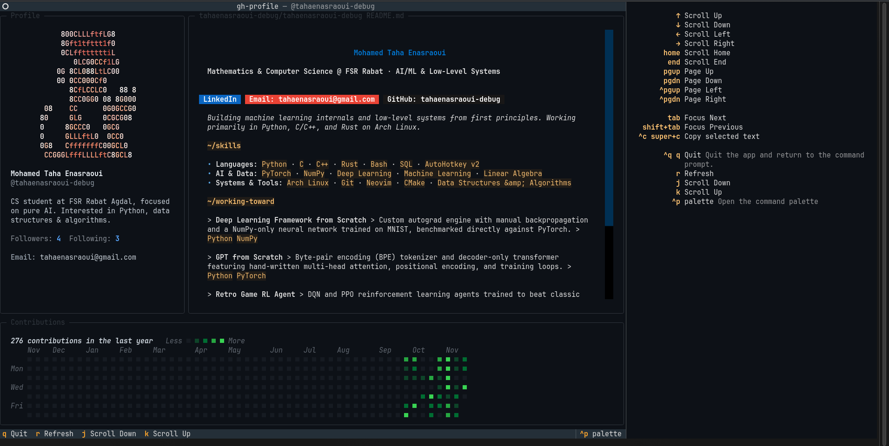

# gh-profile

[](https://github.com/tahaenasraoui-debug/gh-profile/actions/workflows/ci.yml)
[](LICENSE)

A multi-pane terminal UI (TUI) for viewing GitHub user profiles, built with Python, `textual`, and `rich`.



## Features

- **Neofetch-Style ASCII Avatar:** Renders user avatars in 24-bit ANSI RGB ASCII art directly in the terminal using `Pillow`—no external binaries required.
- **Profile Sidebar:** Displays name, handle, pronouns, bio, follower/following counts, location, email, and social links.
- **README Renderer:** Fetches `{username}/{username}/README.md` and pre-processes raw HTML (`<div>`, `<table>`, `<br>`, etc.) and `shields.io` badges into clean Markdown and styled inline pill badges.
- **52×7 Contribution Heatmap:** Renders GitHub's dark-mode 5-level contribution calendar via the GraphQL API (using `GITHUB_TOKEN` or `gh auth token`) with an automatic unauthenticated HTML scraper fallback.
- **Vim-Style Navigation:** Scroll and refresh with `j`, `k`, `r`, and `q` without leaving the keyboard.

## Installation

Requires Python 3.10+.

```bash
git clone https://github.com/tahaenasraoui-debug/gh-profile.git
cd gh-profile
python -m venv .venv
source .venv/bin/activate
pip install -e .
```

## Usage

```bash
gh-profile <username>
```

Example:

```bash
gh-profile tahaenasraoui-debug
```

### Authentication (Optional)

Unauthenticated requests work out of the box, including the contribution heatmap. To avoid GitHub API rate limits and use the GraphQL API for exact contribution counts, either log in with the GitHub CLI or export a personal access token:

```bash
gh auth login
# or
export GITHUB_TOKEN="ghp_your_token_here"
```

## Keybindings

| Key | Action |
| :--- | :--- |
| `j` | Scroll README down |
| `k` | Scroll README up |
| `r` | Refresh profile data |
| `q` | Quit |

## Built With

- [Textual](https://github.com/Textualize/textual) & [Rich](https://github.com/Textualize/rich)
- [HTTPX](https://www.python-httpx.org/)
- [Pillow](https://python-pillow.org/)
- [BeautifulSoup4](https://www.crummy.com/software/BeautifulSoup/)

## Contributing

Contributions, bug reports, and feature suggestions are welcome. For larger changes or new features, please open an issue first to discuss the approach before writing code.

1. Fork the repository and create a branch from `main` (e.g., `git checkout -b fix/short-description` or `feat/short-description`).
2. Keep pull requests focused on a single change and follow the existing code style.
3. Run the local checks before opening a PR:

   ```bash
   ruff check .
   pytest
   ```

4. Open a Pull Request describing what changed and why (link any related issue).

When reporting bugs, please include steps to reproduce, expected vs. actual behavior, and your environment details (OS and Python version).

## License

This project is licensed under the MIT License - see the [LICENSE](LICENSE) file for details.
